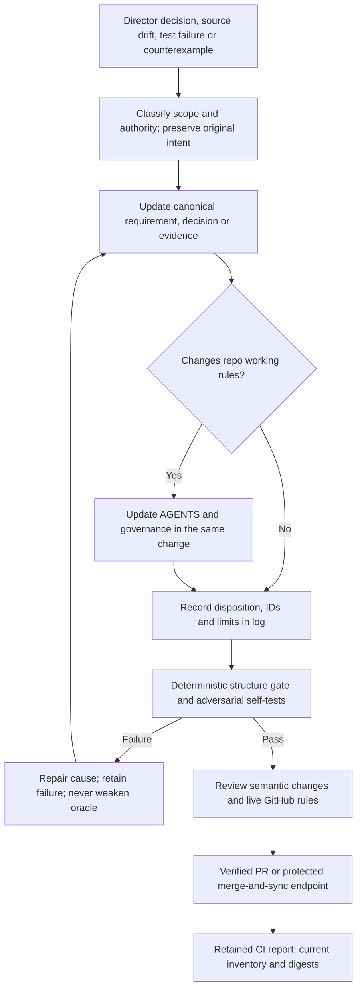

# Scope: this repository, not another product feature

Governance version 1. The Director asked for strict and self-updating governance
in the Rocco repo being created. AGENTS.md is the operating entry point;
specification.md owns product requirements; research-ledger.md owns source claims;
log.md owns accepted directions and change evidence. README/index only navigate.
No background policy writer, runtime governance subsystem or hook is implied.

## Fixed obligations and change control

Preserve R01–R43 from the original request and R44–R70 derived from the harness
review. Preserve all nine axes, P1–P8 and the complete planned acceptance inventory.
New requirements get new stable IDs; supersession records the human authority and
retains the old obligation's disposition. Never silently rename away a failing
requirement, rewrite a test oracle to pass, or call deferred memory implemented.

The user-settled decisions in log.md are distinct from proposed architecture.
Changes to authority, target relaxation, requirement removal or the approval
boundary require explicit human direction, recorded with the relevant IDs. No
agent may infer it from CI passing, a reviewer agreeing or a request to continue.
Ordinary evidence updates and faithful propagation of accepted corrections are
part of the working agent's responsibility, not another approval prompt.

All runtime acceptance still requires full behavior/failure coverage, declared
resource limits, independent verification where claimed, retained failures,
physical baseline evidence, cross-tenant tests and the actual delivery endpoint.
No certification, universal correctness or fastest-possible claim is implied.

## Self-updating control loop

The report is recomputed on pushes/PRs. Agents update canonical rules when new
directions change them; CI checks synchronization and produces evidence rather
than committing its own policy rewrite. No unbounded polling or recurring model
calls are needed. This is the promised maintenance mechanism, not proof that an
arbitrary future agent will obey every prose instruction.

## What the executable gate checks

- Expected documents, supported frontmatter structure and valid local links.
- Unique contiguous requirement, decision, falsifier, execution-cell and axis IDs.
- All requirement rows bind defined decisions and falsifiers; references resolve.
- The frozen minimum inventories cannot silently shrink; additions remain possible.
- Planned crash-case count stays at least 10% and references actual defined cases.
- log.md inventory matches the current source, Mermaid/code fences are closed and
  at least the required four visual diagrams remain in the specification.
- Working instructions retain named owners, the memory hold and honest evidence
  boundary; generated reports hash their source documents.

Frontmatter uses a deliberately bounded YAML subset: scalar lines, inline lists/
maps and indented source-list items. The checker validates that subset, not every
possible YAML document. It does not execute Mermaid, prove prose semantics, check
all cited external URLs, or verify Rust/runtime performance. Syntax/references,
semantic review, renderer checks and runtime acceptance are separate evidence.

## CI and platform enforcement

`Repository governance / docs-check` runs the checker and its negative tests with
read-only repository permissions, a finite timeout and pinned GitHub Actions.
It uploads a report whether checks pass or fail. There is no PR-triggered model
call, host hook, auto-merge or privileged execution of proposed scripts.
CODEOWNERS routes repo governance and acceptance changes to the Director.

At repository creation, live GitHub returned `main.protected=false`, no rulesets
and no applicable branch rules. Thus the current endpoint is a verified open PR;
CODEOWNERS and CI are not a protected-branch merge gate. Reinspect on every
delivery. Required-review enforcement must not be claimed until GitHub actually
enforces it. Anyone able to change the checker can change what it checks; human
diff review is necessary, especially for changes to this contract or test gates.

## File-specific excellence records

| File family | Requirement and predicted effect | Verification and unresolved limit |
|---|---|---|
| README/index/specification | One navigable final proposed specification, original and derived requirements plus visuals | Inventory/link/diff and renderer checks; product behavior NOT RUN |
| research-ledger/log | Pin sources, preserve corrections, distinguish settled decisions and unknowns | Source anchors and inventory reconciliation; not exhaustive source audit |
| AGENTS/GOVERNANCE | Strict same-change maintenance instead of stale rules or product scope creep | Structural anchors and independent review; no claim of perfect agent compliance |
| tools/tests/workflow/CODEOWNERS | Deterministic gate, negative controls, bounded CI and human routing | Actual local/CI results and failing mutants; not enforcement without branch protection |

All nine axes retain the exact invariants/evidence in specification.md Cell 06.
No Rust file exists in this documentation change. Runtime throughput, human
benefit and whole-device resource use remain unmeasured; the documentation tool
is not a proxy for those results.
