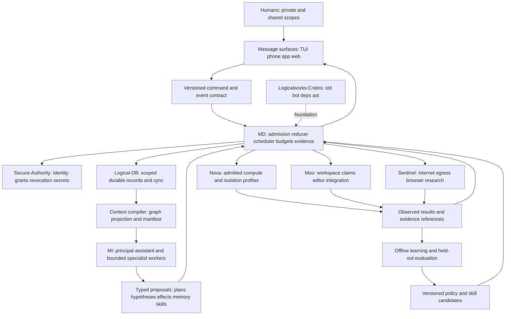
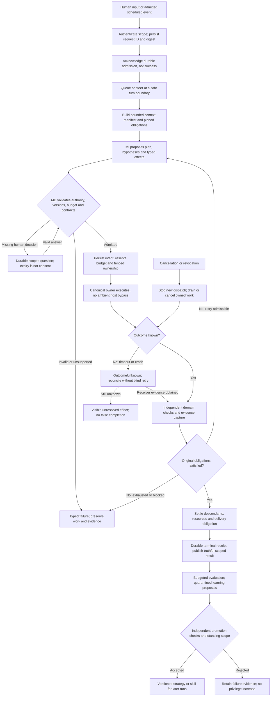

## Cell 02 — candidate architecture graph

Edges denote contracts, not mandatory processes or distributed RPC for every
call. Begin with a modular Rust core and out-of-process untrusted workers. A
deployment can embed trusted components; fleet deployments place the same
contracts across workers. Do not build an independent service for every box.

**Ownership rule:** Larry owns assistant-domain intent, commitments, context
selection and run orchestration. Logical-DB owns persistence/replication; Moo
owns workspace transactions; Nova owns process/compute containment;
Secure-Authority owns authenticated authority; Sentinel owns external access.
References to pre-existing kernel/Braid identities and receipt protocols require
an explicit adapter decision, not a Larry replacement. No cross-repository
charter amendment is fabricated by this candidate.

### Runtime control flow: one request through verified completion

Cancellation enters reconciliation: it does not turn an accepted remote effect
into a non-event. A resumed request returns to its durable position, not always
to Plan. The terminal result distinguishes completed, failed, cancelled and
unresolved dispositions. The learning edge is not mandatory idle inference and
cannot rewrite the current run's grader.
