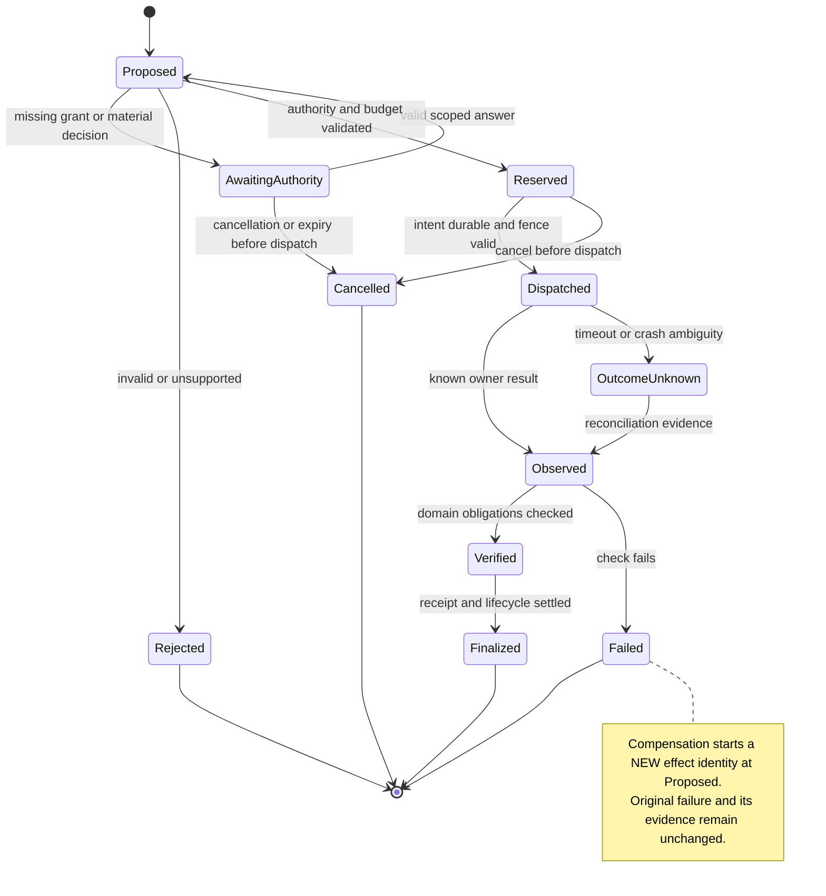

### Effect state machine: interruption is not rollback

OutcomeUnknown is deliberately not drawn as automatic retry or success. Failed
and unresolved outcomes retain evidence and can end a run with unmet obligations;
the diagram does not require compensation to succeed or imply universal reversal.

### Implementation status: the runtime exists (2026-09-20)

`crates/larry-runtime` implements the control flow above as a deterministic,
bounded tick over an authoritative journal. This is an implementation record,
not a new decision: no requirement, decision, falsifier or execution cell is
added, and the inventory stays 96/53/80/13/9.

Implemented: admission with identity-based duplicate suppression; the pure
authorization gate of D36, with the pinned snapshots recorded alongside each
decision so the decision stays replayable (E55); durable intent written before
dispatch; observe, reconcile and the permanent unknown of R72; a bounded
retry budget kept separate from a bounded reconciliation budget; cancellation
that completes only once owned work has stopped; immutable terminal receipts;
and restoration by re-folding the journal.

Not implemented, and not claimed: no canonical owner is integrated, the journal
is in memory with no durability claim, and the effect-boundary re-validation
exists but is not yet driven by a live authority source. ADR-R05 in
`docs/architecture/runtime.md` records the deliberate open question of whether
an ECS world may ever hold authority; ADR-R06 records that the `bevy_ecs`
dependency is pending sign-off and is not an edge.

## Cell 03 — notable decisions and rejected alternatives

Each D row has a falsifier in Cell 09. Director-settled directions are identified
in Cell 12; the remaining mechanisms are proposed. The design owner
is the named responsibility; implementation work must designate a maintainer.

### D01 — MI proposes; MD enforces the operational contract

Choose a deterministic reducer over validated commands/events, not a monolithic
LLM loop. MI interprets ambiguous language, proposes plans, diagnoses, ranks and
communicates. MD checks authority, versions, budgets, scheduling, effect
admission, evidence obligations and lifecycle. Deterministic means repeatable
given recorded inputs, not omniscient about ethics or semantic correctness.
Uncertainty must remain representable. Domain validators and independent human
judgment remain necessary. Reject a second LLM that can silently authorize the
first LLM's effects. E01; owner Larry control plane.

### D02 — continuity is a durable commitment graph, not an immortal context

Choose separate typed records for original requests, current commitments,
decisions, corrections, task state, evidence, user preferences, hypotheses and
procedures. Every derived statement has source references, scope, confidence,
valid time and supersession. Unfinished commitments and explicit corrections
cannot disappear through summarization or relevance decay. Only an authorized
cancel/supersede transition closes them. One principal assistant renders this
state across models/devices; worker identity remains inspectable. Reject a
permanent full-transcript prompt and opaque model-only memory. E02; owner Larry
memory semantics over Logical-DB storage.

### D03 — persona is an explicit, scoped relationship model

Choose user-editable tone, verbosity, humor, vocabulary and interaction
preferences; keep private-personal, project-shared and organization policy
scopes distinct. Terminology entries bind phrase to concept, examples, scope,
provenance and ambiguity; context-sensitive meanings coexist. Explicit user
definitions override inferred habits within their authority, not other users'
preferences. Never infer authorization from intimacy, praise or anger. Make the
assistant warm and distinctive without claiming sentience, exclusivity or hidden
work. Disagreement concerns the action, not the person's worth. Reject engagement
maximization and personality updates that change factual standards. E05/E14;
owner relationship/context layer.
