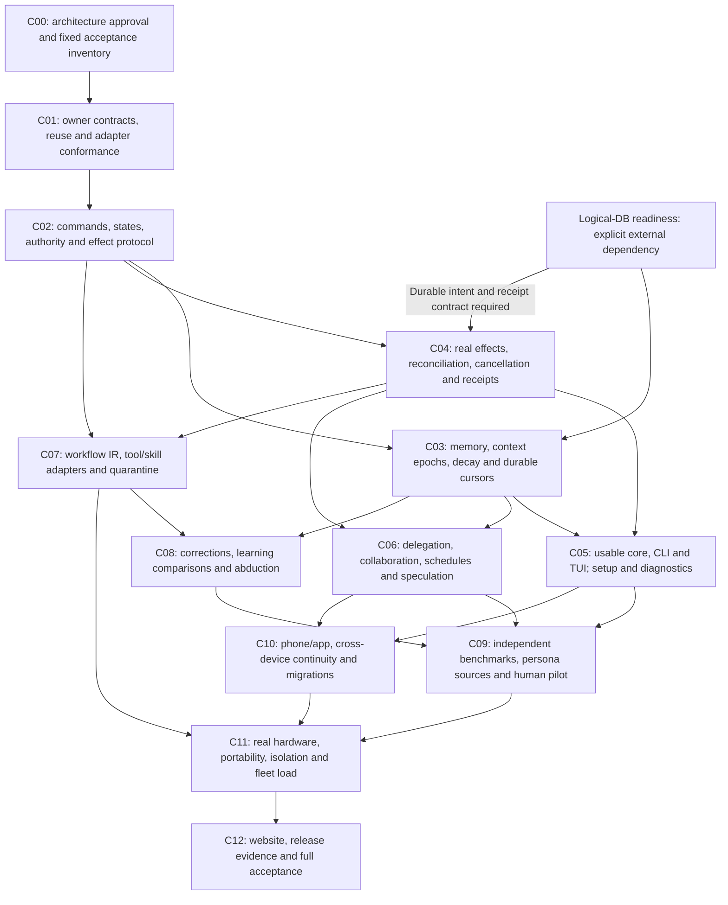

## Cell 11 — completion sequence and experiment outputs

These are notebook-style execution cells, not invented existing CLI commands.
Once implementation exists, each cell receives the repository-discovered exact
command and captured output. Never fill an output cell with expected results.

| Cell | Inputs / decision dependency | Work and artifact | Exit/falsifier |
|---|---|---|---|
| C00 | This specification, R01–R96 | human approval record with exceptions; freeze acceptance v1.2 | no implicit approval, E24 |
| C01 | D21, sibling snapshots | exact adapter/API/source-license manifest; reuse selected code via canonical owner | E22; blockers tracked in owner, no vendor twins |
| C02 | D01/D07/D18, P1–P3 | typed command/event/effect/terminal contract and finite state model | adversarial replay and authority model checks, independent review |
| C03 | D02/D04/D27/D33, P4/P7, Logical-DB readiness | scoped commitments, context epochs, background cursors and adjustable decay; no substitute store | E02/E09/E14/E31/E40/E41/E46, bounded growth |
| C04 | D08/D11/D13, Nova/Moo/SA and Logical-DB durability readiness | one real authorized effect + observation + receipt + cancellation path | E01/E07/E11/E13/E19; no mock-only completion |
| C05 | C03/C04, D14/D19 | external-caller sample and TUI messaging path | E15/E20, real fresh installation and external developer |
| C06 | D09/D10/D17 | bounded delegation/federation + speculation + conflicts | E08/E10/E18; serial baseline retained |
| C07 | D20, audited existing Flow | validated workflow IR, candidate Rhai frontend, scoped skills | E21/E26; compare typed builder before frontend lock |
| C08 | D06/D12, immutable trials | correction pipeline, bandit shadow policy, abductive probes | E04/E12; transfer/poison falsifiers, no silent online training |
| C09 | D15 + frozen workloads | same-model/Claude Code/MatrAIx evaluation, human pilot | E03/E05/E16/E27; raw costs and confidence intervals |
| C10 | D19/D23 | phone/app continuity, migration, offline/weak network | E20/E25 on actual target devices |
| C11 | D22 + measured shard capacity | fleet scale, portability, security/lifecycle soak | E17/E23 and all A1–A9; 1000 cycles and physical baseline |
| C12 | all required cells | website surface, supported release artifacts, runbook and retained evidence | independent acceptance, verified repository delivery endpoint |

Additional case allocation: C02 owns E28/E30/E35/E47;
C03 owns E31/E40/E41/E46; C04 owns E34/E52; C05 owns E29/E33/E42/E43/E44/E51;
C06 owns E37/E38/E39/E54; C07 owns E32; C09 owns E49/E53; C10 owns E45;
C12 owns E50. C04 also owns E48; C05 owns E06/E36; C01 also owns E57; C02 also owns E55;
C03 also owns E60; C04 also owns E56; C05 also owns E58; C06 also owns E59;
C09 also owns E61/E62. C02 also owns E63/E65/E71; C03 also owns E66/E67/E70;
C04 also owns E64/E69/E72; C05 also owns E75; C06 also owns E68;
C09 also owns E76/E77/E80; C11 also owns E78/E79; C12 also owns E73/E74. Every case must run
before full product acceptance. These
allocations do not authorize product implementation or bypass the memory hold.

### Implementation DAG: dependencies, not a promise of parallel readiness

No arrow bypasses memory readiness with a substitute store. Contract research,
stateless protocol work and independent owner checks can proceed before that
dependency is ready, but the full persistent-assistant milestone cannot. All
applicable tests accompany their cell; C09/C11 do not postpone basic correctness.

C06–C10 can contain parallel experiments only after their shared contracts are
frozen; schema/authority ownership remains singular. Core usability can be
reported for an explicitly passed integration slice without calling the full
product complete. No cell drops later requirements. Dependency readiness may
require sibling work, but this governance task does not authorize those edits.

## Cell 12 — unresolved decisions and approval package

**Director-settled:** the Larry name (Rocco until 2026-11-06) and one repository;
core + TUI first; bounded unattended work; adapters rather than clones; defer
memory implementation until Logical-DB is ready; adjustable automatic decay and
user-facing behavioral scales. Strict self-updating governance applies to this
repository (AGENTS.md/GOVERNANCE.md), not an extra runtime product feature.

Recommended package: approve remaining D01–D41 architecture principles,
including scoped persona, safe RL promotion, typed IR, standing permissions,
strict owner reuse, pure-authorization replay identity, unified
reconciliation contracts, ecosystem protocol adapters and evaluation
hardening. Approve the measurement plans as
targets, not a billable evaluation run. Preserve these conditional mechanisms:
Rhai vs existing Flow frontend; exact model/quantization selection; authoritative
fencing/revocation support; Nova isolation profiles per OS; cross-service receipt
schema convergence; retention/legal-hold policy; capacity topology and spend.

These are not questions handed back without recommendations: default choices
are typed IR, capability-negotiated CPU-capable model adapters, one fenced run
owner, no native fallback for isolation, owner-linked receipts and scoped
retention. Their implementation is blocked until the underlying contracts are
verified. Research can continue independently.

**What this package does not establish:** frontier superiority, global optimality,
million-user performance, universal mistake prevention, safe arbitrary shell
translation, immediate offline revocation, lossless compaction, deterministic
LLM regeneration, demographic realism, human satisfaction or production
reliability. Future enhancements are cheaper only if this contract and evidence
discipline hold; no plan can eliminate every future architectural discovery.
